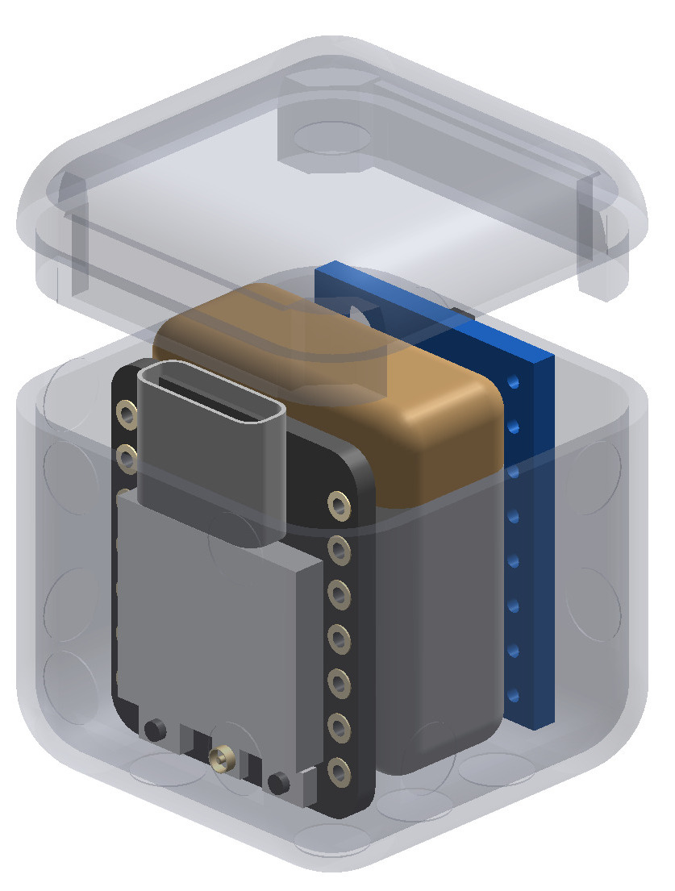
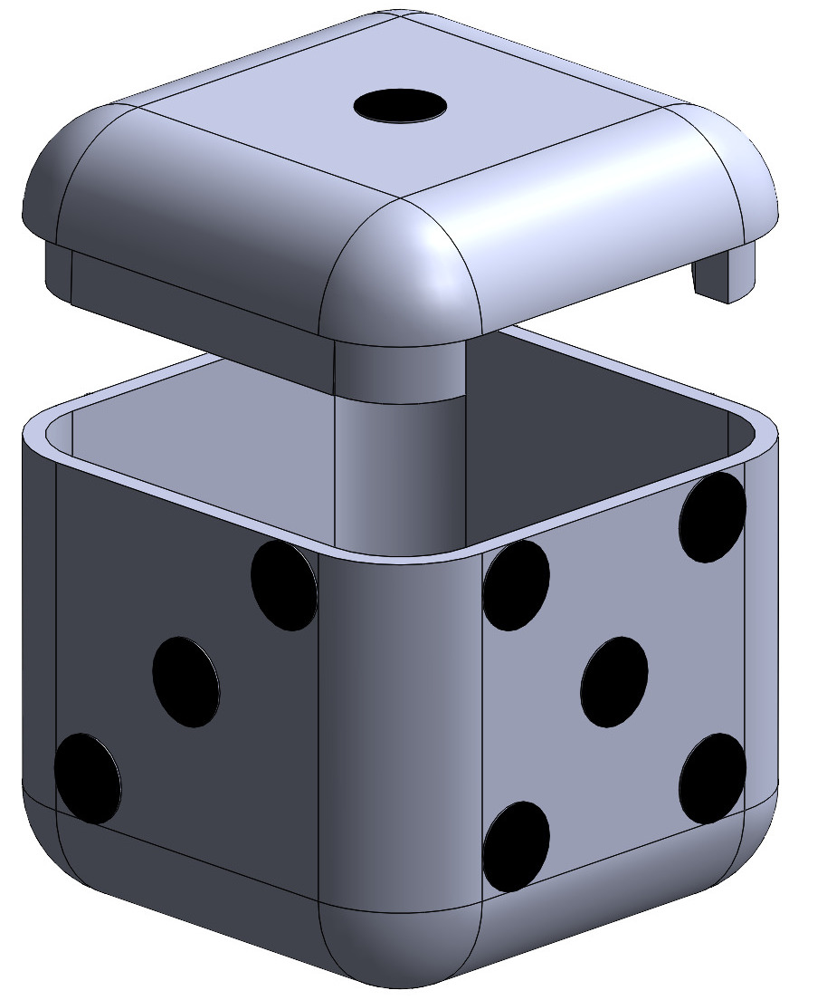

# Smart Dice

  
  

A 3D-printed dice with electronics inside. It detects which side is facing up and shows the result on your phone. The dice creates its own Wi-Fi network, so no router or internet is needed.

**Status:** prototype

## Why I built it

I wanted a small project that combines electronics, firmware and mechanical design in one device: a board small enough to fit inside a dice, powered by a battery, and a case that I designed and printed myself.

## What I did

- Chose the components and wired the electronics
- Designed the dice enclosure in SolidWorks and 3D printed it
- Wrote the firmware for the ESP32-C3 (reading the sensor, detecting the top side, running the Wi-Fi access point)
- Made the phone interface that displays the result

## How it works

1. The MPU6050 measures acceleration (and rotation) of the dice.
2. The ESP32-C3 reads the sensor over I2C and works out which side points up from the direction of gravity.
3. The ESP32-C3 runs as a **Wi-Fi access point**. The phone connects to it and opens the page that shows the rolled number.

## Hardware

| Part | Purpose |
|------|---------|
| ESP32-C3 Super Mini | Microcontroller with Wi-Fi |
| MPU6050 breakout board | Accelerometer and gyroscope for detecting the top side |
| Small Li-ion battery | Power supply |

## Mechanical design and 3D printing

The enclosure was modeled in **SolidWorks**. It is designed to hold the board, sensor and battery inside a dice shape.

- STL file for printing: [`models/smart-dise.STL`](models/smart-dise.STL)
- Material and settings: [PLA, 0.2 mm layer height, 20 % infill]
